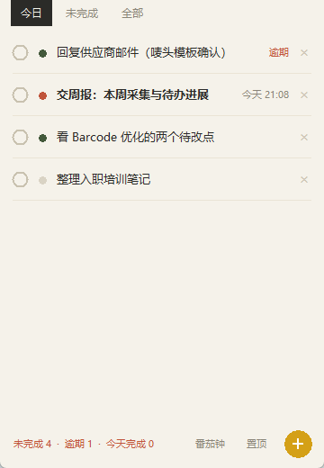

# 屏幕时间记录器

本地优先的 Windows 屏幕使用记录工具：记录你在用什么应用、看什么内容，形成可回看的时间事件流。

## 当前能力

- 前台窗口事件采集（`SetWinEventHook` 事件驱动 + 250ms 轮询兜底）
- 噪音过滤（系统窗口 / 输入法 / Alt+Tab / 搜索宿主等）
- UWP 应用识别（`ApplicationFrameHost` → 真实进程）
- 空闲（AFK）与锁屏 / 解锁检测
- 可见性快照（1s 检测、布局变化才写，为 V1 分屏时间线预留）
- SQLite 本地存储（apps 去重 + 事件 append-only + WAL）
- 规则分类 + CLI 统计 / 导出 / 删除
- 系统托盘（今日统计、暂停/继续、开机自启、退出）
- **抖音内容级**：开启抖音「读屏标签」后，记录具体视频的 `@作者 · 标题`
- **筛选规则**：
  - 应用统计：低于 1 分钟的活动段不记录；常驻工具（PixPin / pythonw / WindowsTerminal）与桌宠（`dsh-pet`）不计入
  - 内容明细：低于 1 分钟的内容不展示，但其时长仍计入应用统计
- **待办与提醒**：单视图待办窗（右下角 ＋ 行内新建 / 点标题直接改 / 优先级圆点 / 一步删除）+ 托盘气泡到点提醒（免打扰、不重复）
- **番茄钟**：待办行内一键开始；专注结束弹置顶小窗，休息完自动接下一轮；全程照常记录，并用真实数据生成专注报告（工作/娱乐占比、Top 应用与内容）

## 环境

- Windows 10/11
- Python 3.13，**需要带 tkinter 的完整安装**（待办窗口依赖；部分精简版/嵌入式 Python 没有）
- 依赖见 `requirements.txt`

自检：

```bat
python -c "import tkinter, win32gui, psutil, flask; print('deps OK')"
```

## 安装

```bat
python -m pip install -r requirements.txt
```

## 启动（推荐双击）

- 双击桌面「屏幕时间记录器」快捷方式，或 `start.bat`
- 托盘右键：今日统计 / 打开仪表盘 / 待办清单 / 快速添加待办 / 暂停采集 / 开机自启 / 退出
- 停止：`stop.bat`，或右键托盘「退出」

> 已做单实例保护：重复启动会提示"已在运行"，不会双份采集。

## 仪表盘（实时）

采集器常驻时会同时启动本地仪表盘：

- 地址：**http://127.0.0.1:8765/**
- 入口：右键托盘 →「打开仪表盘」
- 能力：日/周视图切换、日期选择（前后一天 + 日期选择器）、点击应用条形**下钻**查看页面/内容明细
- 数据实时读库，不需要手动导出
- 图表库（Chart.js / ECharts）已内置在 `assets/vendor/`，**离线可用，不依赖外网**
- 仅监听 `127.0.0.1`，不对局域网/外网开放

### 专注时间高亮（高价值时间）

时间线上方多了一条**金色「专注轨」**：番茄钟每跑完一段专注，就在对应时段画一条金色标记，
下方色带同时加金色描边。悬停该时段，浮层会多一行「◆ 专注 25 分钟 · 待办名」。

- 只统计**已结束、实际专注 ≥1 分钟**的番茄钟会话（中止的也算，跑满 1 分钟才画）
- 描边深浅 = 实际专注 / 会话跨度，中途暂停越久越淡
- **不把「工作类应用」自动当成专注**：只有真正开了番茄钟的时间才高亮，
  避免把"开着 VS Code 发呆"算成高价值时间

### 时间线交互

| 操作 | 效果 |
|---|---|
| **悬停** | 跟随鼠标显示该时刻的「时间区间 · 时长 · 应用 · 类别 · 内容标题」，并高亮对应色块 |
| **滚轮** | 以鼠标位置为中心放大（最小 5 分钟），视窗始终夹在当天活动范围内，不会越出左右边界 |
| **右上角「还原」** | 放大后出现，点一下回到当天全景 |
| **点击色块** | 打开编辑浮层（空白处不响应） |

### 数据编辑（改分类 / 删段）

点击时间线色块，或在下钻抽屉点某段右侧「编辑」，可：

- **改分类**：选「工作 / 浏览网页 / 娱乐 / 社交通讯 / 系统 / 未分类」，可勾选「应用到该应用全部时段」
- **删除该段**：只从统计与图表中排除，**原始事件不删除**（可随时撤销）
- **撤销**：时间线右上角「撤销上次编辑」；下钻抽屉里还有该应用的完整编辑记录，可逐条撤销

编辑记录存在 `edits` 表，优先级高于规则引擎；改完立即重算，刷新页面也不丢。

独立启动（调试用）：

```bat
python main.py dashboard
```

## 待办与提醒



托盘右键 →「待办清单」打开便笺窗；「快速添加待办…」会打开窗口并直接进入新建行。

### 窗口操作（单视图，无弹窗、无视图切换）

| 操作 | 效果 |
|---|---|
| **点右下角 ＋** | 列表末尾出现一行输入框，`Enter` 保存、`Esc` 取消 |
| **单击标题** | 该行**原地**变输入框；`Enter` 或**点击任意空白区域**保存、`Esc` 还原 |
| **点行首圆点** | 优先级循环：低（灰）→ 中（绿）→ 高（红）→ 低 |
| **点左侧圆圈** | 完成 / 取消完成 |
| **点右侧 ×** | 直接删除，无确认弹窗 |
| **点底部「置顶」** | 窗口保持在其他窗口之上，不被盖住；再点一次取消（按钮变「已置顶」高亮） |
| **F5** | 手动刷新 |

- 排序：未完成 → 逾期优先 → 临近优先 → 优先级
- 窗口位置和大小会记住，下次打开保持原样
- 单实例：重复打开只会激活已有窗口
- **置顶状态会记住**：切换后立即写入 `todo_window.json`，关掉重开自动恢复（默认不置顶）
- **不预设滚动区**：内容没超过窗口高度时不显示滚动条、滚轮无效；超出才自动出现滚动条
- **点击任意空白区域自动保存**：编辑或新建时，点输入框以外的任何位置（列表空白、筛选、其他按钮）都会保存；点输入框自身不提交
- 行内编辑期间会暂停 3 秒轮询，避免输入框被刷新重建
- 写操作在后台线程完成，界面只做**局部更新**（改色 / 改文字 / 销毁单行），不会因整表重建而卡顿
- 失焦保存有 80ms 防抖，避免点击瞬间焦点抖动把输入框立刻提交

> 当前界面只暴露「标题 / 完成 / 优先级 / 删除」四项。备注、截止、提醒时间的**数据字段保留、已有待办的提醒照常触发**，但本轮不提供编辑入口（见 `9-待办界面精简改造方案.md`）。

### 提醒规则

- 每 **20 秒**检查一次到期待办，通过 **Windows 托盘气泡**提醒
- **不重复**：先写 `reminded_ts` 再弹，异常重启也不会重复轰炸
- **不打扰**：锁屏或连续 15 分钟无输入时暂不弹，恢复后自动补
- **不刷屏**：同一时刻多条到期合并成一条；启动时超过 6 小时的历史逾期合并成一条
- 点击气泡 → 打开待办窗

> 待办窗口是**独立进程**，关掉它不影响采集与提醒（气泡兜底）。
> 数据通过本地 API（`127.0.0.1:8765/api/todos`）读写，主进程是唯一写入方。

## 番茄钟

### 开始

**从待办开始（推荐）**：每行右侧都有「专注」。点一下**不会立刻开始**，
而是先在底部展开时长设置（默认上次用的时长，可 ±5 或直接输入），面板上会写
「为「待办名」专注」；点「开始专注」才真正开始，并把这条待办绑到会话上（标题会进结束报告）。

正在专注的那一行会变成倒计时，再点展开控制面板（暂停 / 结束 / 看剩余时间）。

托盘右键 →「番茄钟」子菜单：

| 菜单项 | 作用 |
|---|---|
| **自由专注（X 分钟）** | 不绑待办，用上次的时长直接开始 |
| **在待办窗口选任务开始…** | 打开待办窗，点行内「专注」 |
| **自定义时长与休息…** | 打开待办窗口，底部展开时长面板 |
| **暂停 / 继续** | 专注中可用 |
| **结束本次** | 中止（已专注满 1 分钟会保留半程报告） |

### 时长（手动选择，记住上次）

- 专注 **5–180 分钟**、休息 **0–60 分钟**（0 = 只专注不休息）
- 步进按钮每次 ±5 分钟；数字可直接输入
- 非法输入（空 / 字母 / 超范围）失焦时静默回退，不弹错误框
- 改过的值立即保存，下一次开始（含行内「专注」）就用新值

### 专注结束 → 提醒 → 下一轮

专注到点后，屏幕右下角会弹一个**置顶小窗**（比托盘气泡可靠，且直接可操作）：

```
专注 25 分钟完成
整理唛头打印需求 · 专注率 82%
[ 休息 5 分后继续 ] [ 只休息 5 分 ] [ 结束 ]
```

三个选择：

| 选择 | 行为 |
|---|---|
| **休息 5 分后继续** | 休息到点**立即自动开始下一轮**，继承同一待办、同一专注时长 |
| **只休息 5 分** | 只跑休息；休息到点后**回到时间界面**（时长面板自动展开），下一步由你决定 |
| **结束** | 直接回空闲，不休息 |

- 小窗 30 秒无操作自动收起；状态仍在托盘与待办窗口里，随时可以继续操作
- 休息时长在设置面板里改；设为 0 时没有休息，「休息后继续」退化为「开始下一轮」

选「休息后继续」时，休息结束会再弹一个 5 秒轻提示「已开始下一个番茄」，循环是：
**专注 → 弹窗 → 休息 → 自动下一个专注**，不需要回托盘点菜单。

选「只休息」时，休息结束不自动开始，待办窗口会自动展开时长面板，等你决定下一步。

### 计时规则

- 专注期间**照常记录**所有前台应用与内容，不做任何屏蔽
- **锁屏** → 自动暂停；解锁后只提示，不自动继续
- **不检测键鼠空闲**：看视频、读文档、开会、思考时长时间不动是常态，不会因为没碰键鼠而暂停
- 开始与恢复后的前 10 秒有宽限期，避免状态切换瞬间误判
- 主进程重启会恢复未结束的会话；超出计划 2 分钟以上标记为 interrupted
  （崩溃恢复后不会自动续接下一轮，需要手动点一次）

### 专注报告

结束时按 `[开始, 结束]` 区间统计真实数据：

```
计划 50 分钟 · 实际专注 46 分 12 秒（2 次暂停，共 3 分 48 秒）
工作 83% · 浏览网页 11% · 娱乐 6%
Top 应用：VS Code 32 分 / Chrome 8 分 / 抖音 2 分 47 秒
```

报告存入会话快照（`report_json`），之后改分类/删段不会篡改历史结论。

> 托盘气泡（`NOTIFYICONDATAW`）不支持按钮，所以它只做兜底通知；带「休息 / 下一轮」按钮的是右下角置顶小窗。

## 命令行

```bat
python main.py start          REM 启动常驻（托盘）
python main.py todo           REM 打开待办窗（--focus 聚焦输入框）
python main.py status         REM 事件/快照条数
python main.py today          REM 今日统计（含内容明细）
python main.py yesterday      REM 昨日统计
python main.py apps           REM 已记录应用
python main.py export 2026-10-24 csv    REM 导出（csv/json）
python main.py delete 2026-10-24        REM 删除某天
python main.py autostart      REM 开机自启
python main.py noautostart    REM 取消开机自启
```

## 数据位置

- 数据库：`%USERPROFILE%\.screen_time_recorder\events.db`
- 日志：`%USERPROFILE%\.screen_time_recorder\tray.log`
- 所有数据仅存本机，不上传。

## 隐私

- IM 类（微信 / 飞书 / QQ / 钉钉）默认只记时长，窗口标题留空。
- 抖音内容级需要开启抖音「读屏标签」；只在抖音前台时读取当前视频标题/作者，写入本地库。
- 可用 `delete <日期>` 删除某天原始数据。

## 已知限制

- 抖音内容级依赖「读屏标签」，关闭后自动降级为应用级（只记"抖音"）。
- 睡眠/合盖检测、虚拟桌面污染、精确 AFK 切割尚未实现。
- 快照的 `visibility` 目前只记 `visible`（V1 补 focus/hidden）。
- 待办为本机单机，暂无重复待办、子任务、日历视图（P2 规划）。
- 番茄钟 P0 未做：置顶小浮窗、每日目标、音效、专注守护（P1/P2 规划）；时长选择在待办窗口内，托盘菜单只做"用上次配置一键开始"。
- 番茄钟报告依赖采集数据；刚开始使用、或采集被暂停时，报告可能显示"没有可用的采集数据"。
- 托盘气泡可能被 Windows「专注助手 / 通知」设置拦截；若收不到提醒，检查系统通知设置。

## 目录结构

```
main.py                  入口（start / todo / status / today / export / delete / autostart）
start.bat                一键启动（探测带 tkinter 的 Python）
screen_time_recorder/
  config.py              配置常量（实测依据见《3-技术调研报告》）
  collector.py           前台/标题/锁屏事件采集 + ContentFetcher
  douyin_content.py      抖音 UIA 内容抓取
  snapshot.py            可见性快照
  storage.py             SQLite 存储与查询（含 todos / edits / settings / pomodoro）
  classifier.py          活动派生 / 分类 / 内容聚合
  reminder.py            待办提醒调度（20s tick / 免打扰 / 合并）
  pomodoro.py            番茄钟服务（状态机 / 计时 / 专注报告）
  todo_window.py         tkinter 待办便笺窗（独立进程，含番茄钟面板）
  cli.py                 统计 / 导出 / 删除
  tray.py                pywin32 原生托盘 + 气泡通知 + 番茄钟菜单
  daemon.py              采集/快照/心跳线程编排
  dashboard.py           仪表盘数据聚合
  web.py                 本地仪表盘 + 待办/番茄钟 REST API
probes/                  调试与验证脚本
tests/                   自动化测试
```
