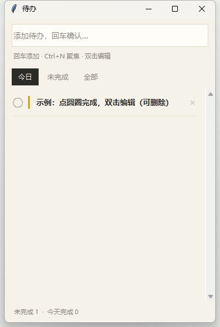

# 屏幕时间记录器

本地优先的 Windows 屏幕使用记录工具：记录你在用什么应用、看什么内容，形成可回看的时间事件流。

## 当前能力

- 前台窗口事件采集（`SetWinEventHook` 事件驱动 + 250ms 轮询兜底）
- 噪音过滤（系统窗口 / 输入法 / Alt+Tab / 搜索宿主等）
- UWP 应用识别（`ApplicationFrameHost` → 真实进程）
- 空闲（AFK）与锁屏 / 解锁检测
- 可见性快照（1s 检测、布局变化才写，为 V1 分屏时间线预留）
- SQLite 本地存储（apps 去重 + 事件 append-only + WAL）
- 规则分类 + CLI 统计 / 导出 / 删除
- 系统托盘（今日统计、暂停/继续、开机自启、退出）
- **抖音内容级**：开启抖音「读屏标签」后，记录具体视频的 `@作者 · 标题`
- **筛选规则**：
  - 应用统计：低于 1 分钟的活动段不记录；常驻工具（PixPin / pythonw / WindowsTerminal）与桌宠（`dsh-pet`）不计入
  - 内容明细：低于 1 分钟的内容不展示，但其时长仍计入应用统计
- **待办与提醒**：便笺式待办窗（增删改查 / 完成 / 优先级 / 截止与提醒时间）+ 托盘气泡到点提醒（免打扰、不重复）

## 环境

- Windows 10/11
- Python 3.13，**需要带 tkinter 的完整安装**（待办窗口依赖；部分精简版/嵌入式 Python 没有）
- 依赖见 `requirements.txt`

自检：

```bat
python -c "import tkinter, win32gui, psutil, flask; print('deps OK')"
```

## 安装

```bat
python -m pip install -r requirements.txt
```

## 启动（推荐双击）

- 双击桌面「屏幕时间记录器」快捷方式，或 `start.bat`
- 托盘右键：今日统计 / 打开仪表盘 / 待办清单 / 快速添加待办 / 暂停采集 / 开机自启 / 退出
- 停止：`stop.bat`，或右键托盘「退出」

> 已做单实例保护：重复启动会提示"已在运行"，不会双份采集。

## 仪表盘（实时）

采集器常驻时会同时启动本地仪表盘：

- 地址：**http://127.0.0.1:8765/**
- 入口：右键托盘 →「打开仪表盘」
- 能力：日/周视图切换、日期选择（前后一天 + 日期选择器）、点击应用条形**下钻**查看页面/内容明细
- 数据实时读库，不需要手动导出
- 图表库（Chart.js / ECharts）已内置在 `assets/vendor/`，**离线可用，不依赖外网**
- 仅监听 `127.0.0.1`，不对局域网/外网开放

### 时间线交互

| 操作 | 效果 |
|---|---|
| **悬停** | 跟随鼠标显示该时刻的「时间区间 · 时长 · 应用 · 类别 · 内容标题」，并高亮对应色块 |
| **滚轮** | 以鼠标位置为中心放大（最小 5 分钟），视窗始终夹在当天活动范围内，不会越出左右边界 |
| **右上角「还原」** | 放大后出现，点一下回到当天全景 |
| **点击色块** | 打开编辑浮层（空白处不响应） |

### 数据编辑（改分类 / 删段）

点击时间线色块，或在下钻抽屉点某段右侧「编辑」，可：

- **改分类**：选「工作 / 浏览网页 / 娱乐 / 社交通讯 / 系统 / 未分类」，可勾选「应用到该应用全部时段」
- **删除该段**：只从统计与图表中排除，**原始事件不删除**（可随时撤销）
- **撤销**：时间线右上角「撤销上次编辑」；下钻抽屉里还有该应用的完整编辑记录，可逐条撤销

编辑记录存在 `edits` 表，优先级高于规则引擎；改完立即重算，刷新页面也不丢。

独立启动（调试用）：

```bat
python main.py dashboard
```

## 待办与提醒



托盘右键 →「待办清单」打开便笺窗；「快速添加待办…」会打开窗口并直接聚焦输入框。

### 窗口操作

| 操作 | 效果 |
|---|---|
| **回车** | 添加待办（标题即内容） |
| **点左侧圆圈** | 完成 / 取消完成 |
| **双击某行** | 编辑：备注、截止时间、提醒时间、优先级 |
| **点右侧 ×** | 删除（二次确认） |
| **Ctrl+N** | 聚焦输入框 |
| **F5** | 手动刷新 |

- 时间输入支持 `2026-11-05 18:00`、`11-05 18:00`、`18:00`（当天/次日该时刻）
- 排序：未完成 → 逾期优先 → 临近优先 → 优先级
- 窗口位置和大小会记住，下次打开保持原样
- 单实例：重复打开只会激活已有窗口

### 提醒规则

- 每 **20 秒**检查一次到期待办，通过 **Windows 托盘气泡**提醒
- **不重复**：先写 `reminded_ts` 再弹，异常重启也不会重复轰炸
- **不打扰**：锁屏或连续 15 分钟无输入时暂不弹，恢复后自动补
- **不刷屏**：同一时刻多条到期合并成一条；启动时超过 6 小时的历史逾期合并成一条
- 点击气泡 → 打开待办窗

> 待办窗口是**独立进程**，关掉它不影响采集与提醒（气泡兜底）。
> 数据通过本地 API（`127.0.0.1:8765/api/todos`）读写，主进程是唯一写入方。

## 命令行

```bat
python main.py start          REM 启动常驻（托盘）
python main.py todo           REM 打开待办窗（--focus 聚焦输入框）
python main.py status         REM 事件/快照条数
python main.py today          REM 今日统计（含内容明细）
python main.py yesterday      REM 昨日统计
python main.py apps           REM 已记录应用
python main.py export 2026-10-24 csv    REM 导出（csv/json）
python main.py delete 2026-10-24        REM 删除某天
python main.py autostart      REM 开机自启
python main.py noautostart    REM 取消开机自启
```

## 数据位置

- 数据库：`%USERPROFILE%\.screen_time_recorder\events.db`
- 日志：`%USERPROFILE%\.screen_time_recorder\tray.log`
- 所有数据仅存本机，不上传。

## 隐私

- IM 类（微信 / 飞书 / QQ / 钉钉）默认只记时长，窗口标题留空。
- 抖音内容级需要开启抖音「读屏标签」；只在抖音前台时读取当前视频标题/作者，写入本地库。
- 可用 `delete <日期>` 删除某天原始数据。

## 已知限制

- 抖音内容级依赖「读屏标签」，关闭后自动降级为应用级（只记"抖音"）。
- 睡眠/合盖检测、虚拟桌面污染、精确 AFK 切割尚未实现。
- 快照的 `visibility` 目前只记 `visible`（V1 补 focus/hidden）。
- 待办为本机单机，暂无重复待办、子任务、日历视图（P2 规划）。
- 托盘气泡可能被 Windows「专注助手 / 通知」设置拦截；若收不到提醒，检查系统通知设置。

## 目录结构

```
main.py                  入口（start / todo / status / today / export / delete / autostart）
start.bat                一键启动（探测带 tkinter 的 Python）
screen_time_recorder/
  config.py              配置常量（实测依据见《3-技术调研报告》）
  collector.py           前台/标题/锁屏事件采集 + ContentFetcher
  douyin_content.py      抖音 UIA 内容抓取
  snapshot.py            可见性快照
  storage.py             SQLite 存储与查询（含 todos / edits）
  classifier.py          活动派生 / 分类 / 内容聚合
  reminder.py            待办提醒调度（20s tick / 免打扰 / 合并）
  todo_window.py         tkinter 待办便笺窗（独立进程）
  cli.py                 统计 / 导出 / 删除
  tray.py                pywin32 原生托盘 + 气泡通知
  daemon.py              采集/快照/心跳线程编排
  dashboard.py           仪表盘数据聚合
  web.py                 本地仪表盘 + 待办 REST API
probes/                  调试与验证脚本
tests/                   自动化测试
```
